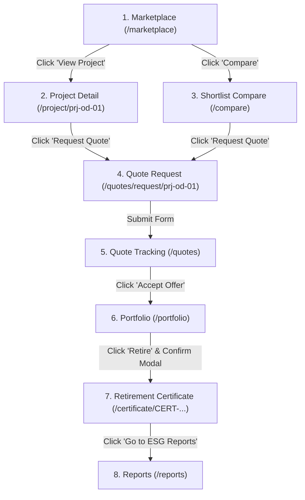

# Carbonly Reference Prototype – Design Handoff Specification (`HANDOFF.md`)

> **Target Audience:** UI/UX Designers & Figma System Architects  
> **Source Repository:** `Carbonly Reference Prototype`  
> **Aesthetic Tone:** Trustworthy, modern, fintech × climate-tech (Groww-inspired minimalism: clean whitespace, rounded cards, subtle shadows, bold numbers, minimal nav, restrained charts).

---

## 1. Design Token System (CSS Variables Source of Truth)

All color values in the application are strictly driven by CSS variables in `src/tokens/tokens.css`. Never hard-code hex values in component design files.

### 🎨 Brand Palette
| Variable Name | Hex Code | Purpose & Usage Rule |
|---------------|----------|----------------------|
| `--color-deep-green` | `#16342B` | Brand identity, footer background, floating compare bar, active headings |
| `--color-forest-green` | `#2D6A4F` | **Primary Brand Green**: Primary CTAs, positive status badges, active indicators |
| `--color-accent-green` | `#40916C` | Focus rings, borders on selected states, chart secondary line |
| `--color-dark-blue` | `#1B3A57` | Admin brand accent, enterprise compliance tags |
| `--color-white` | `#FFFFFF` | Card surfaces, modal surfaces, primary elevated panels |
| `--color-light-neutral` | `#EEF2ED` | **App Canvas Background**, metric stat cards, chip backgrounds |
| `--color-light-blue-grey`| `#E9EEF3`| Secondary container backgrounds, registry badges |

> **⚠️ Restrained Green Rule:**  
> Green is strictly reserved for primary CTA buttons, positive/verified states, selected toggles, and key metric numbers. Backgrounds remain crisp white or light neutral (`#EEF2ED`). The app never feels overwhelmingly green.

### 🔤 Typography Scale (Font: Inter)
| Token Style | Size | Weight / Line-Height | Figma Style Name |
|-------------|------|----------------------|------------------|
| `--font-page-heading` | `30px` (`1.875rem`) | SemiBold 700 / `1.25` | `Heading / Page Title` |
| `--font-section-heading` | `22px` (`1.375rem`) | SemiBold 600 / `1.3` | `Heading / Section` |
| `--font-card-heading` | `18px` (`1.125rem`) | SemiBold 600 / `1.4` | `Heading / Card Title` |
| `--font-body` | `15px` (`0.9375rem`) | Regular 400 / `1.5` | `Body / Regular` |
| `--font-body-medium` | `15px` (`0.9375rem`) | Medium 500 / `1.5` | `Body / Medium` |
| `--font-muted` | `13px` (`0.8125rem`) | Regular 400 / `1.45` | `Caption / Muted` |
| `--font-small-bold` | `13px` (`0.8125rem`) | SemiBold 600 / `1.4` | `Caption / Bold` |
| `--font-numeric-lg` | `32px` (`2rem`) | Bold 700 / `1.15` | `Display / Big Numeric (INR & Credits)` |
| `--font-numeric-md` | `24px` (`1.5rem`) | Bold 700 / `1.2` | `Display / Card Numeric` |

### 📐 Radii & Shadows
- **Radii:** `xs: 4px`, `sm: 6px`, `md: 10px`, `lg: 16px`, `xl: 20px`, `full: 9999px`
- **Shadows:**  
  - Card Subtle: `0 1px 3px rgba(18, 38, 30, 0.06)`
  - Elevated Hover: `0 4px 14px rgba(18, 38, 30, 0.07)`
  - Modals / Popups: `0 20px 40px rgba(18, 38, 30, 0.16)`

---

## 2. Reusable Component Inventory

| Component | Path | Variants & Configurations | Figma Component Mapping |
|-----------|------|---------------------------|-------------------------|
| **StatusPill** | `src/components/StatusPill` | 8 Standard States + Dot: `Pending`, `Under Review`, `Verified`, `Listed`, `Sold`, `Retired`, `Rejected`, `Draft`, `Responded`, `Accepted`. Sizes: `sm`, `md`. | `Components/StatusPill` |
| **Button** | `src/components/Button` | `primary`, `secondary`, `outline`, `ghost`, `danger`. Sizes: `sm`, `md`, `lg`. Supports loading spinner & disabled. | `Components/Button` |
| **Input / Select** | `src/components/Input` | Normal, Focus with `--focus-ring`, Error with `role="alert"` and error message, Prefix (`₹`), Suffix (`Credits`). | `Components/Input` |
| **Card / StatCard** | `src/components/Card` | Default, Bordered, Elevated. `StatCard` with big numeric display and trend pills. | `Components/Card` |
| **Table** | `src/components/Table` | Semantic header (`<th scope="col">`), sortable columns, responsive horizontal wrapper. | `Components/Table` |
| **Modal** | `src/components/Modal` | Accessible dialog (`aria-modal="true"`), backdrop overlay, focus trap, `Esc` dismiss. | `Components/Modal` |
| **Stepper** | `src/components/Stepper` | Multi-step progress indicator: `upcoming`, `current` with `aria-current="step"`, `completed` with checkmark. | `Components/Stepper` |
| **Chip** | `src/components/Chip` | Selectable pill filter chips for categories and types. | `Components/Chip` |
| **TopNav** | `src/components/Nav` | Sticky header with brand logo, persona switcher dropdown (Buyer, Seller, Admin), role-dependent nav links, mobile drawer. | `Components/TopNav` |
| **Chart** | `src/components/Chart` | Pure SVG `LineChart` (price trends), `BarChart` (monthly volumes), `DonutChart` (GHG scopes). WCAG AA accessible with text alternatives. | `Components/Chart` |

---

## 3. 18 Screens to Figma Frames Mapping

### 👤 Buyer Persona (9 Screens)
1. **`Buyer-01-Dashboard` (`/`)**:
   - Welcome banner with corporate ESG verification pill.
   - 4 Groww-style bold KPI cards (Active Volume, Retired Offsets, Valuation in ₹, Open RFPs).
   - "Primary Flow Walkthrough" quick launchpad banner.
   - Featured projects grid spotlight.
2. **`Buyer-02-Marketplace` (`/marketplace`)**:
   - Top search input and category chips.
   - Desktop filter sidebar / Mobile bottom filter drawer (Price slider, Type, State, Vintage, Quantity, Registry).
   - Sortable project cards with big bold prices (`₹1,250 / credit`), available volume, and methodology tag.
   - Triple prototype states: Normal, Skeleton Loading, Empty, and Error panels.
   - Floating compare shortlist pill bar (`Compare (2–4)`).
3. **`Buyer-03-ProjectDetail` (`/project/:id`)**:
   - Breadcrumb navigation.
   - Hero header with registry badge, spot price, and liquidity metric.
   - 4-step lifecycle stepper (`Feasibility → Validation → Verification → Issuance`).
   - Project narrative & UN SDG co-benefit badges.
   - Audited documentation checklist with simulated PDF download.
   - 6-month historical price trend SVG chart.
   - Sticky bottom action bar (desktop & mobile) with "Request Quote" and "Compare".
4. **`Buyer-04-Compare` (`/compare`)**:
   - Side-by-side comparison matrix for 2–4 projects.
   - **Zero auto-ranking** (pure objective technical comparison).
   - Sticky header column on mobile/tablet horizontal scroll.
5. **`Buyer-05-QuoteRequest` (`/quotes/request/:projectId`)**:
   - Institutional RFP form with client-side volume limits and price validation.
   - Live calculation sidebar showing total gross settlement in ₹.
   - Zero pre-payment escrow guarantee note.
6. **`Buyer-06-QuoteTracking` (`/quotes`)**:
   - Status tabs: `All`, `Pending`, `Responded`, `Accepted`, `Rejected`.
   - List + Detail split view.
   - Official seller counter-offer card with "Accept Offer" and "Decline Offer" triggers.
7. **`Buyer-07-Portfolio` (`/portfolio`)**:
   - Summary cards (Total volume, valuation in ₹, total retired).
   - Holdings table with "Retire" CTA.
   - Portfolio diversification donut chart.
   - Executed certificates grid with direct links to certificates.
   - Accessible retirement confirmation modal.
8. **`Buyer-08-RetirementCertificate` (`/certificate/:id`)**:
   - Formal cryptographic certificate framing.
   - Verifiable registry serial range and SHA-256 blockchain escrow hash.
   - Simulated QR verification stamp.
   - Dedicated print stylesheet (`@media print`).
9. **`Buyer-09-Reports` (`/reports`)**:
   - Date range selector (`FY 2023-24`, `Q3 2024`, `Last 30 Days`).
   - Cumulative carbon sequestration progress line chart.
   - Monthly retirement volume bar chart.
   - GHG Protocol Scope 1/2/3 breakdown donut chart.
   - Simulated CSV and Audit PDF export buttons.

---

### 🏢 Seller Persona (5 Screens)
10. **`Seller-01-OnboardingWizard` (`/seller/onboarding`)**:
    - 6-step progress stepper: *Company Info → Contact → Business Verification → Documents → Review → Submit*.
    - Simulated document upload zone with PDF/PNG/JPG whitelist enforcement.
11. **`Seller-02-Dashboard` (`/seller/dashboard`)**:
    - Available inventory volume, gross revenue in ₹, pending inquiries.
    - Recent inquiries response drawer.
    - Quick actions: "Register New Project", "Manage Inventory".
12. **`Seller-03-AddProject` (`/seller/projects/new`)**:
    - Project registration form with validation on name, registry, volume, price, methodology.
    - Document attachment UI.
    - "Save Draft" and "Submit for Admin Review" actions.
13. **`Seller-04-Inventory` (`/seller/inventory`)**:
    - Inventory ledger table by batch number with allocated, available, and sold quantities.
    - Status tabs (`Listed`, `Under Review`, `Sold`, `Draft`).
    - Triple states: Normal, Skeleton Loading, Empty state.
14. **`Seller-05-Inquiries` (`/seller/inquiries`)**:
    - Buyer inquiry inbox with target prices and volumes.
    - Interactive counter-quote modal to propose binding price and delivery schedule.

---

### 🛡️ Admin Persona (4 Screens)
15. **`Admin-01-Dashboard` (`/admin/dashboard`)**:
    - Clearing volume velocity chart, registry distribution.
    - Verification queue backlog and listing review backlog cards.
16. **`Admin-02-SellerVerificationQueue` (`/admin/verification`)**:
    - Seller KYC audit table with GSTN status and risk scores.
    - Document review modal with simulated PDF document viewer.
    - "Approve Corporate KYC" and "Reject Verification" controls.
17. **`Admin-03-ListingApproval` (`/admin/listings`)**:
    - Listing review cards.
    - Interactive 5-point methodological checklist (Additionality, Baseline, Land Title, Registry Letter, DNSH Safeguards).
    - "Approve & Publish to Marketplace" and "Reject / Return" actions.
18. **`Admin-04-UsersTransactions` (`/admin/users-transactions`)**:
    - Two tabbed views: "Market Participants" and "Transaction Audit Trail".
    - Searchable, sortable, paginated audit tables.

---

### 🎨 Showcase Screen (1 Screen)
19. **`DesignSystem-Showcase` (`/design-system`)**:
    - Live interactive component and token showroom for Figma designer inspection.

---

## 4. End-to-End Clickable Primary Flow Walkthrough

All state is persistently synchronized through `CarbonAppContext`!
